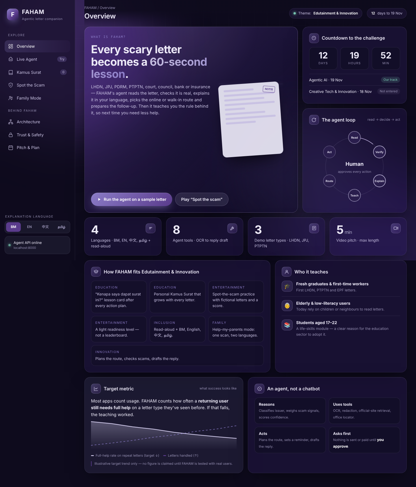
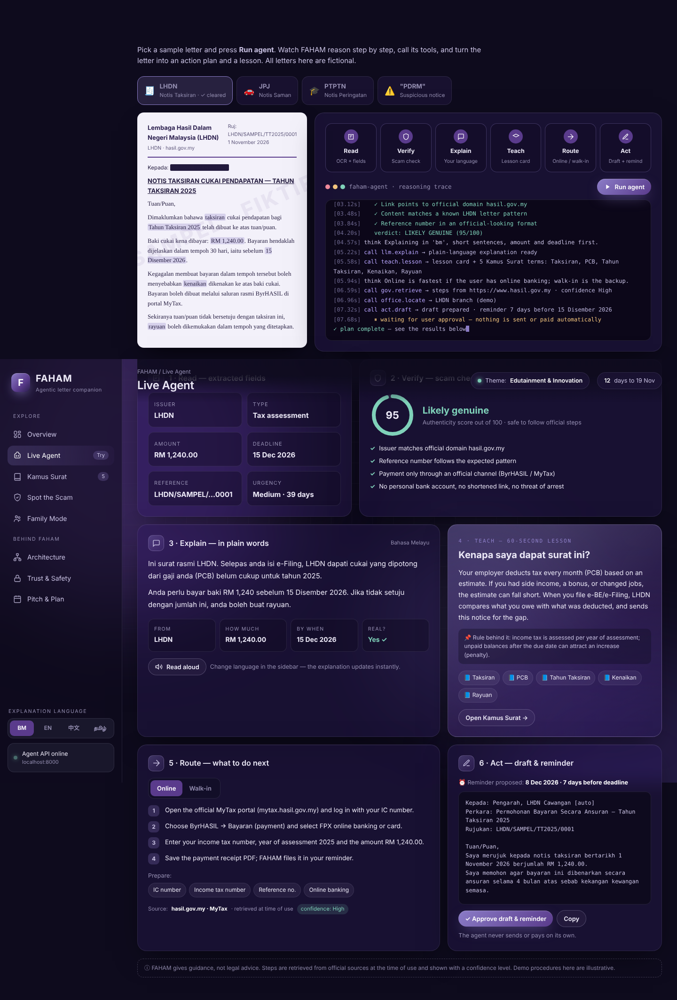
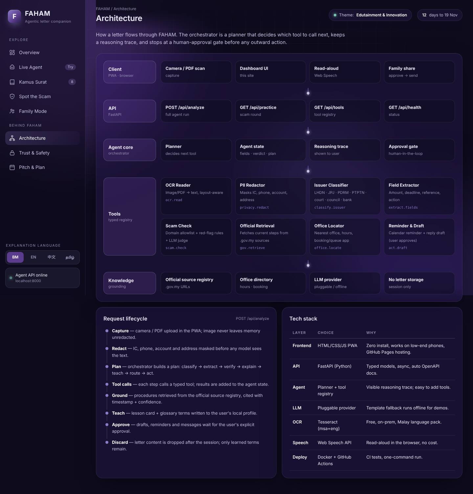

# FAHAM: Agentic AI letter companion

> **Faham surat. Faham langkah. Faham hak anda.**
> Every scary letter becomes a 60-second lesson, so people need help less each time.

FAHAM is our UTHM team's entry for the **Agentic AI Challenge** at **Festival Idea Putrajaya 2026** (19 Nov 2026; theme: *Edutainment & Innovation*).

Many Malaysians struggle with letters from LHDN, JPJ, PDRM, PTPTN, the courts, local councils, banks and insurers. FAHAM is an **agent, not a chatbot**. For each letter it:

1. **Reads** the letter (OCR, PII redaction, issuer classification, field extraction)
2. **Verifies** it is real (domain allowlist, red-flag rules, reference patterns)
3. **Explains** it in plain words in BM, English, 中文 or தமிழ், with read-aloud
4. **Teaches** the rule behind it with a *"Kenapa saya dapat surat ini?"* card and adds the letter's terms to a personal *Kamus Surat*
5. **Routes** the user online (click by click) or walk-in (nearest office, hours, booking, documents to bring)
6. **Acts** by drafting the reply and a reminder. **The user approves before anything is sent or paid.**

The **Spot-the-scam** practice mode and **Family mode** ("help my parents") run on the same agent.

---

## Screenshots

| Overview | Live agent | Architecture |
|---|---|---|
|  |  |  |

## Repository layout

```
faham/
├── frontend/                 # Dashboard: static HTML/CSS/JS, no build step
│   ├── index.html
│   └── assets/
│       ├── css/styles.css    # Glass bento design system (palette below)
│       ├── js/config.js      # API_BASE; falls back to in-browser demo mode
│       ├── js/data.js        # Fictional sample letters, glossary, practice set, team
│       ├── js/intro.js       # "Welcome to FAHAM" neural-network intro animation
│       └── js/app.js         # Views, agent simulation, practice, family mode
├── backend/                  # FastAPI agent service
│   ├── app/
│   │   ├── main.py           # /api/analyze, /api/practice, /api/tools, /api/health
│   │   ├── models.py         # Typed Pydantic contracts
│   │   ├── llm.py            # Pluggable LLM (offline templates by default)
│   │   ├── config.py
│   │   ├── agent/
│   │   │   ├── orchestrator.py   # read → verify → explain → teach → route → act
│   │   │   └── tools.py          # Tool registry (10 tools)
│   │   └── data/             # Official source registry, demo offices, practice set
│   ├── tests/test_agent.py
│   ├── requirements.txt / requirements-dev.txt
│   ├── Dockerfile
│   └── .env.example
├── docs/
│   ├── ARCHITECTURE.md       # System design and diagrams (Mermaid)
│   ├── AGENT_FLOW.md         # Decision flow, tools, trace format
│   ├── API.md                # Endpoint reference
│   ├── PRIVACY_SAFETY.md     # Risks and mitigations, PDPA design goals
│   └── PITCH_PLAN.md         # 5-minute video outline and next steps
├── .github/workflows/
│   ├── ci.yml                # Backend tests on every push / PR
│   └── pages.yml             # Deploys frontend/ to GitHub Pages
├── docker-compose.yml
├── LICENSE
└── .gitignore
```

## Quick start

### 1. Dashboard only (no install)
Open `frontend/index.html` in a browser, or serve it:
```bash
python3 -m http.server 5500 -d frontend
# → http://localhost:5500
```
With no backend running, the sidebar shows **Demo mode** and the agent runs entirely in the browser.

### 2. Dashboard and agent API
```bash
cd backend
python3 -m venv .venv && source .venv/bin/activate   # Windows: .venv\Scripts\activate
pip install -r requirements-dev.txt
uvicorn app.main:app --reload --port 8000           # API docs at http://localhost:8000/docs
```
Then serve the frontend on port 5500 as above. The sidebar switches to **Agent API online**, and the reasoning trace now comes from the real orchestrator.

### 3. Docker
```bash
docker compose up --build
# Frontend → http://localhost:8080   API → http://localhost:8000/docs
```

### Tests
```bash
cd backend && pytest -q
```

## Deploying to GitHub Pages
1. Push this repo to GitHub.
2. Go to **Settings → Pages → Source: GitHub Actions**.
3. The `pages.yml` workflow publishes `frontend/` on each push to `main`. The public site runs in demo mode. To use a hosted API, set `API_BASE` in `frontend/assets/js/config.js` and add the site's origin to `FAHAM_ALLOWED_ORIGINS`.

## Optional: LLM explanations
FAHAM works offline using templates. To generate richer explanations, set these in `backend/.env`:
```
FAHAM_LLM_PROVIDER=anthropic
ANTHROPIC_API_KEY=...
```
Only **redacted** text is ever sent to the model.

## Design system
| Token | Hex | Use |
|---|---|---|
| Ink | `#0E0B1D` | Page background |
| Plum | `#2a1e4d` | Glass card base |
| Violet | `#5a3b8c` | Primary accent, active states |
| Lavender | `#8b7cc7` | Highlights, links, glow |
| Mist | `#c9c2e3` | Secondary text, light accents |
| Slate | `#3a3a52` | Neutral surfaces |

Cards are frosted glass (`backdrop-filter: blur(18px)`) over animated plum and violet orbs, laid out in a 12-column bento grid.

## Important
- **All letters, names, IC numbers and accounts in this repo are fictional.** Never use real people's letters in the demo or practice mode.
- FAHAM gives **guidance, not legal advice**. Procedures must be retrieved from official sources at the time of use. Office data in `backend/app/data/offices.json` is demo data only.
- Chinese and Tamil strings should be reviewed by a native speaker before the demo.

## Team
UTHM: Yb, Kevinraj, Muhammad Aqil, Larm Kai Xian. Advisor: Dr. Ramhuzaini bin Abd Rahman.

## License
MIT. See [LICENSE](LICENSE).
