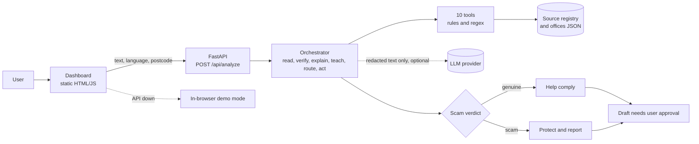

# FAHAM: Agentic AI letter companion

> **Faham surat. Faham langkah. Faham hak anda.**
> Every scary letter becomes a 60-second lesson, so people need help less each time.

FAHAM is the UTHM team's entry for the **Agentic AI Challenge** at **Festival Idea Putrajaya 2026** (19 Nov 2026, theme: *Edutainment & Innovation*). It helps people who struggle with official letters from LHDN, JPJ, PDRM, PTPTN, courts, councils and banks.

For each letter the agent:

1. **Reads** it: OCR hook, PII redaction, issuer classification, field extraction
2. **Verifies** it: domain allowlist and red-flag rules give a genuine or scam verdict
3. **Explains** it in BM, English, 中文 or தமிழ், with read-aloud
4. **Teaches** the rule behind it ("Kenapa saya dapat surat ini?") and grows a personal *Kamus Surat*
5. **Routes** the user online or walk-in (nearest office, hours, booking, documents)
6. **Acts** by drafting a reply and a reminder. The user approves; nothing is sent or paid automatically.

Spot-the-scam practice and Family mode run on the same agent.


## Architecture



- **Deterministic first, LLM second.** Classification, extraction and scam checks are testable rules. The LLM only rewrites the explanation and is off by default, so the demo works offline.
- **Redact before anything else.** The API is stateless and stores no letters.
- **The plan changes on evidence.** A scam verdict switches the agent from "help comply" to "protect and report".
- **Human in the loop.** Every action is a draft with `requires_approval: true`.

More detail: [Architecture](docs/ARCHITECTURE.md) · [Agent flow](docs/AGENT_FLOW.md) · [API](docs/API.md) · [Privacy and safety](docs/PRIVACY_SAFETY.md) · [Research](docs/RESEARCH.md) · [Notes](docs/NOTES.md)

## Repository layout

```
frontend/   static dashboard, no build step (config.js sets API_BASE)
backend/
  app/main.py            routes: /api/health /api/tools /api/analyze /api/practice
  app/agent/             orchestrator.py and tools.py (tool registry)
  app/data/              official_sources.json, offices.json (demo), practice.json
  app/llm.py             optional Anthropic call
  tests/                 pytest
docs/       design notes and research
```

## Setup

Requirements: Python 3.12 or newer. Docker is optional. Node is not needed.

### 1. Dashboard only (demo mode)
```bash
python -m http.server 5500 -d frontend
# open http://localhost:5500
```
With no API running the sidebar shows **Demo mode** and the agent runs in the browser.

### 2. Dashboard and API
```bash
cd backend
python -m venv .venv
source .venv/bin/activate        # Windows: .venv\Scripts\activate
pip install -r requirements-dev.txt
uvicorn app.main:app --reload --port 8000    # docs at http://localhost:8000/docs
```
In a second terminal serve the frontend on port 5500 as above. The sidebar switches to **Agent API online** and the reasoning trace comes from the real orchestrator.

Opening `frontend/index.html` straight from disk needs `FAHAM_ALLOW_NULL_ORIGIN=1` in the API's environment.

### 3. Docker
```bash
docker compose up --build
# web http://localhost:8080    API http://localhost:8000/docs
```
The API image runs as a non-root user with a healthcheck, and nginx adds security headers (`frontend/nginx.conf`).

### Tests
```bash
cd backend && pytest -q
```

### Configuration
Copy `backend/.env.example` to `backend/.env`.

| Variable | Default | Purpose |
|---|---|---|
| `FAHAM_ALLOWED_ORIGINS` | localhost :5500 and :8080 | Origins allowed by CORS. Add your site when hosting |
| `FAHAM_ALLOW_NULL_ORIGIN` | `0` | Set `1` only to call the API from a `file://` page |
| `FAHAM_LLM_PROVIDER` | `none` | `anthropic` to enable LLM explanations |
| `ANTHROPIC_API_KEY` | empty | Needed when the provider is `anthropic` |
| `FAHAM_LLM_MODEL` | `claude-sonnet-5-5` | Model for explanations |

Only **redacted** text is sent to the model, and the call is skipped if long digit runs remain. For image OCR install `pytesseract` and `pillow` (the Docker image already includes Tesseract).

## Deploying
**GitHub Pages:** in *Settings → Pages* choose *GitHub Actions*. `pages.yml` publishes `frontend/` on every push to `main` in demo mode. To use a hosted API, set `API_BASE` in `frontend/assets/js/config.js`, add the site origin to `FAHAM_ALLOWED_ORIGINS`, and update `connect-src` in `frontend/nginx.conf` if you use it.

## Important
- All letters, names, IC numbers and accounts here are **fictional** (marked SAMPEL · FIKTIF). Never use real people's letters.
- FAHAM gives **guidance, not legal advice**. Steps come from a cached official-source registry dated in the response; office data is demo data.
- Chinese and Tamil text needs native-speaker review before the demo.
- Known gaps and next steps are tracked in [docs/NOTES.md](docs/NOTES.md).

## Team
UTHM: Yb, Kevinraj, Muhammad Aqil, Larm Kai Xian. Advisor: Dr. Ramhuzaini bin Abd Rahman.

## License
MIT. See [LICENSE](LICENSE).
