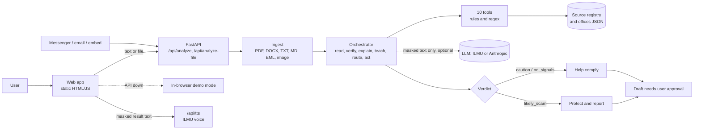

# FAHAM: Agentic AI letter companion

> **Faham surat. Faham langkah. Faham hak anda.**
> Every scary letter becomes a 60-second lesson, so people need help less each time.

FAHAM is an entry for the **Agentic AI Challenge** at **Festival Idea Putrajaya 2026** (19 Nov 2026, theme: *Edutainment & Innovation*). It helps people who struggle with official letters and messages from LHDN, JPJ, PDRM, PTPTN, courts, councils and banks, and it protects them from scams that copy those agencies.

Paste a message, upload a file, or pick a practice example. For each one the agent:

1. **Reads** it: text extraction (PDF, Word, text, Markdown, email, image OCR), personal-detail masking, issuer and field detection
2. **Checks** it for scam signs: official-domain check, red-flag rules and email-header checks. It reports *why* it reached a result and never says "genuine", because look-alike scams can copy every visible detail
3. **Explains** it in short steps in BM, English, 中文 or தமிழ், read aloud by default
4. **Teaches** the rule behind it ("Kenapa saya dapat surat ini?") and grows a personal *Kamus Surat* dictionary
5. **Routes** the user online or walk-in, with steps taken from an official-source registry
6. **Acts** by drafting a reply and a reminder. The user approves; nothing is sent or paid automatically

Also included: **Easy mode** (a switch in the header, on the first page and in the welcome dialog: bigger text, one thing per screen, three short steps, no menus), **Spot the scam** practice, **Family** mode, and **Connect** (website embed, Messenger and email forwarding).

## What the verdict means

| Verdict | Meaning |
|---|---|
| `likely_scam` | Strong scam signs found. Do not pay, click or reply |
| `caution` | Mixed or unknown issuer. Verify before acting |
| `no_signals` | Known issuer and no red flags. **Still verify yourself**: FAHAM cannot see who really sent it |

Every result lists its reasons (risk, good sign, note), and the message sits beside the result with the matching parts highlighted (the original PDF or image has its own tab) and **steps to verify on your own**, independent of the letter. Social media and form links are shown as notes. If an agency has official accounts in the registry (`social` in `official_sources.json`), a different account claiming to be that agency is a red flag.

## Architecture



- **Deterministic first, LLM second.** Classification, extraction and scam checks are testable rules. The LLM only rewrites the explanation and is optional, so the demo works offline.
- **Mask before anything else.** IC, phone, account, email, address, plate, names and long numbers are masked before any LLM or voice call. This is regex-based, best effort. The API is stateless and stores no letters.
- **The plan changes on evidence.** A scam verdict switches the agent from "help comply" to "protect and report".
- **Human in the loop.** Every action is a draft with `requires_approval: true`.

More detail: [Architecture](docs/ARCHITECTURE.md) · [Agent flow](docs/AGENT_FLOW.md) · [API](docs/API.md) · [Integrations](docs/INTEGRATIONS.md) · [Privacy and safety](docs/PRIVACY_SAFETY.md) · [Research](docs/RESEARCH.md) · [Terms and privacy](docs/TERMS_AND_PRIVACY.md) · [Code of Conduct](CODE_OF_CONDUCT.md) · [Terms review notes](docs/TERMS_REVIEW.md) · [Notes](docs/NOTES.md)

## Repository layout

```
frontend/   static web app, no build step (config.js sets API_BASE); embed.html for websites
backend/
  app/main.py            routes: /api/health /api/tools /api/analyze /api/analyze-file /api/practice /api/tts
  app/agent/             orchestrator.py, tools.py (tool registry), i18n.py (verdict text, 4 languages)
  app/ingest.py          file reading: PDF, DOCX, TXT, MD, EML, images
  app/channels.py        Messenger webhook and email forwarding
  app/llm.py, tts.py     ILMU and Anthropic text, ILMU read-aloud
  app/data/              official_sources.json, offices.json (demo), practice.json
  tests/                 pytest
docs/       design notes and research
```

## Setup

Requirements: Python 3.12 or newer. Docker is optional. Node is not needed.

### 1. Web app only (demo mode)
```bash
python -m http.server 5500 -d frontend
# open http://localhost:5500
```
With no API running, the app shows **Demo mode** and the agent runs in the browser.

### 2. Web app and API
```bash
cd backend
python -m venv .venv
source .venv/bin/activate        # Windows: .venv\Scripts\activate
pip install -r requirements-dev.txt
uvicorn app.main:app --reload --port 8000 --env-file ../.env    # docs at http://localhost:8000/docs
```
In a second terminal serve the frontend on port 5500 as above. Opening `frontend/index.html` straight from disk needs `FAHAM_ALLOW_NULL_ORIGIN=1` in the API's environment.

### 3. Docker
```bash
cp .env.example .env     # add your own keys; one file for compose and the API
docker compose up -d --build
# web http://localhost:8080    API http://localhost:8000/docs
```
If port 8080 is busy, put `WEB_PORT=8081` in a root `.env` file. The API image runs as a non-root user with a healthcheck and includes Tesseract for OCR. nginx adds security headers (`frontend/nginx.conf`).

The code is baked into the API image, so after changing backend code run `docker compose up -d --build`; a restart is not enough.

### Tests
```bash
cd backend && pytest -q
```

## Configuration
Copy `.env.example` to `.env` in the repo root (one file for Docker Compose and the API). Never commit it.

| Variable | Default | Purpose |
|---|---|---|
| `FAHAM_ALLOWED_ORIGINS` | localhost :5500 and :8080 | Origins allowed by CORS. Add your site when hosting |
| `FAHAM_ALLOW_NULL_ORIGIN` | `0` | Set `1` only to call the API from a `file://` page |
| `FAHAM_LLM_PROVIDER` | `none` | One or more of `ilmu`, `anthropic`, tried in order (for example `ilmu,anthropic`). A provider without a key is skipped |
| `ILMU_API_KEY` / `ILMU_BASE_URL` | empty / `https://api.ilmu.ai/v1` | Needed for ILMU text and voice |
| `ANTHROPIC_API_KEY` | empty | Needed when the provider is `anthropic` |
| `FAHAM_LLM_MODEL_ILMU` / `FAHAM_LLM_MODEL_ANTHROPIC` | `ilmu-mini-v3.3` / `claude-sonnet-5-5` | Model per provider. Check ILMU `GET /v1/models` for current names |
| `FAHAM_TTS_MODEL` / `FAHAM_TTS_VOICE` | `ilmu-tts-v2.1` / `voice_1` | Read-aloud for BM, EN and 中文. Tamil uses the browser voice. About RM 0.08 per 1,000 characters |

Messenger and email forwarding have their own variables and stay off until set. See [docs/INTEGRATIONS.md](docs/INTEGRATIONS.md).

Only **masked** text is sent to a model or the voice service, and the call is skipped if personal details remain. Uploads are limited to 25 MB and are read in memory, not stored.

## Adding an agency
Add an entry to `backend/app/data/official_sources.json`: `keywords`, `domains`, `source_url`, steps, lesson, terms, and optionally `social` (the agency's official accounts, copied from its own website, for example `"facebook.com/handle"`). Steps must come from the agency's own site.

## Deploying
**GitHub Pages:** in *Settings → Pages* choose *GitHub Actions*. `pages.yml` publishes `frontend/` on every push to `main` in demo mode. Pages has no API. For a live demo use the Cloudflare Tunnel below, which serves both the page and the API.

## Public access with Cloudflare Tunnel
A tunnel puts your local Docker site on a public https address with no open port and no router changes. The `cloudflared` image is pinned to `2026.10.7` in `docker-compose.yml` (check [the releases](https://github.com/cloudflare/cloudflared/releases) before the demo and bump the tag if there is a newer one).

How the traffic flows: `browser -> Cloudflare -> cloudflared -> web (nginx) -> /api/ -> api`. The page and the API share one address, so there is no CORS setup and the API port stays local (`127.0.0.1:8000`).

**Quick tunnel (no account, random `https://....trycloudflare.com` address, for a short demo):**
```bash
docker compose up -d
docker compose --profile quick up -d quicktunnel
docker compose logs quicktunnel      # the https address is printed here
```
The address changes every time the container restarts. Stop it with `docker compose --profile quick stop quicktunnel`.

**Named tunnel (your own hostname, stable):**
1. In the Cloudflare Zero Trust dashboard create a tunnel and copy its token.
2. Add a public hostname for it, for example `faham.example.com`, with the service `http://web:80`.
3. Put the token in the root `.env` (see `.env.example`): `CLOUDFLARE_TUNNEL_TOKEN=...`
4. Start it: `docker compose --profile tunnel up -d`

**Before you share the address:**
- The API calls paid LLM and voice services with your keys. nginx limits each client to about 30 API calls a minute, but anyone with the link can still use your quota. For a judging session put the hostname behind **Cloudflare Access** (email one-time code) or share the link only briefly.
- Only masked text goes to the LLM and voice services, but anything a visitor types or uploads reaches your machine. Keep the consent and privacy notice on.
- Messenger needs a public https webhook: give Meta the callback `https://<address>/api/channels/messenger` (and set `FAHAM_PUBLIC_URL` so the privacy notice links to your Terms page) (see [docs/INTEGRATIONS.md](docs/INTEGRATIONS.md)).
- Uploads over 25 MB are refused, and a tunnel adds a little delay to large files.

## Important
- All sample letters, names, IC numbers and accounts here are **fictional** (marked SAMPEL · FIKTIF). Never commit real people's letters.
- FAHAM gives **guidance, not legal advice**. Steps come from a cached official-source registry dated in the response; office data is demo data.
- Not yet tested live: Messenger and email forwarding against real Meta and mail servers, and OCR on scanned documents.
- Chinese and Tamil text needs native-speaker review, and the Terms and Code of Conduct need a legal read, before the demo.
- Known gaps and next steps are tracked in [docs/NOTES.md](docs/NOTES.md).

## Team
Yb, Kevinraj, Muhammad Aqil, Larm Kai Xian.

## License
MIT. See [LICENSE](LICENSE).
