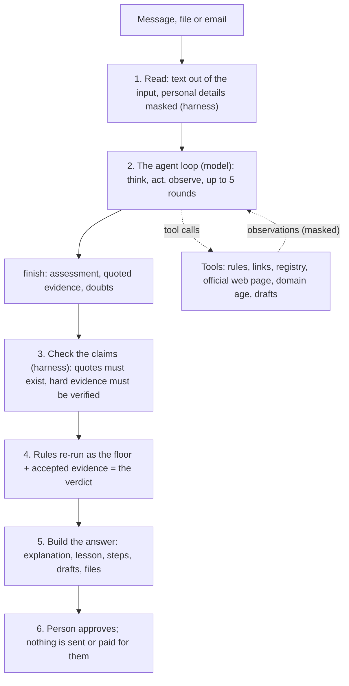

# How the Tulen agent works

This is the one document to read if you want to understand, annotate or change the agent. Everything here matches the code as of 7 November 2026. Where a number or a name is a **setting you can change**, it is marked **[knob]** and listed again in [the tweak guide](#10-tweak-guide).

Contents: [1. At a glance](#1-at-a-glance) · [2. Where the code is](#2-where-the-code-is) · [3. One run, step by step](#3-one-run-step-by-step) · [4. How it plans](#4-how-it-plans) · [5. The tools](#5-the-tools) · [6. How it searches and uses tools](#6-how-it-searches-and-uses-tools) · [7. Can it create its own tools?](#7-can-it-create-its-own-tools) · [8. How it reasons to a verdict](#8-how-it-reasons-to-a-verdict) · [9. Personal data (PII)](#9-personal-data-pii) · [10. Tweak guide](#10-tweak-guide) · [11. What can go wrong](#11-what-can-go-wrong-and-what-happens) · [12. Measuring it](#12-measuring-it) · [13. Not built](#13-what-is-not-built)

---

## 1. At a glance

Tulen gives a language model a **goal** and a set of **tools** and lets it work in rounds of *think, act, observe* until it can justify a conclusion. Plain code (the "harness") wraps the model: it hides personal details first, limits what the model may do, checks everything the model claims, and re-runs the scam rules last as a safety floor. The model can **add concern, never remove it**.



| Question | Short answer |
|---|---|
| Who decides which tools run and in what order? | The **model**, round by round |
| Who decides how serious the message is? | The **harness**: rules plus the model's *checked* evidence. The model's own opinion is reported but not obeyed |
| Can it browse or search the web? | It can **fetch a page from an official agency website** and **look up a website's registration date**. It cannot run a web search or open arbitrary sites |
| Can it create tools? | **No.** It can only call the 8 tools in a fixed list |
| What if no model is available? | The plain rule pipeline runs; the answer has the same shape |
| Where do you read what it did? | The progress screen, the "What Tulen checked" list, and the English technical log at the bottom of a result |

---

## 2. Where the code is

| File | What it holds |
|---|---|
| `backend/app/agent/loop.py` | **The agent**: goal, system prompt, the 8 agent tools, the think-act-observe loop, budgets, guard rails, evidence verification |
| `backend/app/agent/orchestrator.py` | Runs read, then the agent, then builds the answer; re-runs the rules; fills anything the agent skipped; builds the trace |
| `backend/app/agent/tools.py` | The `TOOLS` registry (12 tools: redaction, rules, link inspection, registry, explanation, route, drafts), the scam rules (`RED_FLAGS`), scoring, and the official-source registry loader |
| `backend/app/agent/i18n.py` | Every sentence shown to the user about a finding, in BM, EN, 中文, தமிழ் (the model never writes these) |
| `backend/app/llm.py` | The model call (`chat` for the agent, `complete` for explanations), provider chain, the privacy guard |
| `backend/app/data/official_sources.json` | The official-source registry: agencies, real domains, steps, official social accounts |
| `backend/app/main.py` | API routes, including `POST /api/analyze/stream` (live steps) |
| `backend/evals/run_suite.py` | Measures the agent on real documents and extra hard cases |
| `backend/tests/test_agent_loop.py` | Tests for the loop and its guard rails (scripted model, mocked network) |
| `frontend/assets/js/app.js` | `human()` turns tool results into plain sentences for the progress bar and the "What Tulen checked" list |

---

## 3. One run, step by step

| # | Stage | Who | What happens |
|---|---|---|---|
| 1 | **Read** | harness | `ocr.read` gets the text (OCR for images). `privacy.redact` masks personal details. From here on, only masked text exists ([section 9](#9-personal-data-pii)) |
| 2 | **Agent loop** | model, up to 5 rounds | Each round: the model thinks, may update its plan, calls up to 3 tools, and reads the results. It ends with `finish` |
| 3 | **Check the claims** | harness | Each proposed signal must quote the message; hard signals must also be verified ([section 8](#8-how-it-reasons-to-a-verdict)) |
| 4 | **Fill the gaps** | harness | If the agent skipped `classify_issuer` or `extract_fields`, the harness runs them and lists them in `agent.filled` |
| 5 | **Verdict** | harness | `scam.check` runs on the message with the accepted evidence: rules floor plus evidence |
| 6 | **Explain** | model for genuine-looking messages, templates for scams | `llm.explain` writes a short explanation; a scam gets a fixed template, never model text |
| 7 | **Teach and route** | harness | `teach.lesson`, `gov.retrieve`, `office.locate` from the registry, switched by the verdict |
| 8 | **Act** | harness (+ the agent's choices) | The base draft, plus the family warning, scam report or calendar file the agent asked for, **dropped if they do not fit the verdict** |
| 9 | **Approve** | person | Nothing leaves their hands without their approval |

The page shows steps 1 to 8 live (`/api/analyze/stream`) as a progress bar and a tick list.

---

## 4. How it plans

**There is no hard-coded plan.** The model writes one in round 1 and may revise it in later rounds. What shapes it:

| Condition | Where it comes from | Effect |
|---|---|---|
| The message itself | The masked text, up to **5,000 characters** [knob `MAX_LETTER`] | Has links? names an agency? asks for payment? has a deadline? The model picks tools accordingly |
| Guidance in the system prompt | `SYSTEM` in `loop.py` [knob] | "Skip `inspect_links` if there are no links"; "fetch an official page to check a claim about how the agency takes payment"; "check a suspicious website with `domain_intel`"; "never repeat a call that already answered"; "stop as soon as you can justify a conclusion"; "be conservative: ordinary notices, surveys and polite requests are not scams" |
| Context facts | `_prompt()` | The reply language, and whether a postcode was given (the value is **not** sent) |
| What it has learned so far | `history` | Every earlier round's thought and the masked observations are in the next prompt, including **tool errors**, so it can replan |
| Budgets | constants in `loop.py` [knobs] | **5 rounds**, **3 tools per round**, **4 outside lookups**, **50 seconds**. On the last round (or after 50 s) the prompt says it must finish now |
| The tool menu | `AGENT_TOOLS` | Names, argument descriptions and one-line purposes are the model's only view of what it can do |

**What the model sends each round** (one JSON object, `max_tokens` 700):

```json
{"thought": "what I think and why",
 "plan": ["step", "step"],
 "actions": [{"tool": "lookup_registry", "args": {"issuer": "LHDN"}}],
 "finish": null}
```

**To finish**, it sends `"actions": []` and:

```json
"finish": {"assessment": "likely_scam | caution | no_signals",
           "summary": "one or two sentences",
           "signals": [{"category": "ai_payment_demand", "quote": "exact words from the message"}],
           "doubts": ["what could make me wrong"],
           "drafts": ["family_warning"]}
```

A failed or unreadable model answer is retried **once** [knob `_ask`]. If it still fails, the loop stops and the harness carries on with what is known. If the very first call fails, the plain rule pipeline runs.

**After the loop** the harness also decides things the model cannot:

| Harness condition | Result |
|---|---|
| The agent skipped the issuer or the key facts | Harness runs them; listed in `agent.filled` |
| Final verdict is **not** a scam | The family warning is dropped; the scam report is not built |
| Final verdict **is** a scam | The calendar reminder is dropped |
| The agent's own assessment differs from the checked verdict | The trace says so; the verdict follows the checked evidence |

---

## 5. The tools

### The 8 tools the agent can call (`AGENT_TOOLS` in `loop.py`)

| Tool | Arguments | What it does | Leaves the server? | Limits |
|---|---|---|---|---|
| `classify_issuer` | none | Works out which agency the message claims to be from (keywords and domains vs the registry) | No | |
| `extract_fields` | none | Pulls out the amount, deadline and reference number | No | |
| `run_rules` | none | Runs Tulen's scam rules and returns the rules' verdict and why | No | Same rules as the floor |
| `inspect_links` | none | Looks at every link: bare IP, punycode, `@` trick, shortener, odd ending (`.top`, `.xyz`...), look-alike of an agency name, plain `http`, a path that asks you to log in or pay | No | No page is opened |
| `lookup_registry` | `issuer` (optional) | The registry entry: real websites, official source, how the agency takes payment | No | Only agencies in `official_sources.json` |
| `fetch_official_page` | `url`, `look_for` (up to 5 words) | **Downloads a page from the agency's real website** and checks whether it mentions the given words | **Yes**: the URL only | https only; registry domains or `.gov.my` only; redirects off those are refused; 8 s; 700 KB; counts against the 4 outside lookups |
| `domain_intel` | `domain` | Does a website named in the message resolve, and **when was it registered** (RDAP)? | **Yes**: the domain name only | The domain must appear in the message; 4 outside lookups |
| `prepare_draft` | `kind` | Prepares something for the person to approve: `family_warning`, `scam_report` (built later from the final findings) or `reminder_ics` (a calendar file for the deadline) | No | Needs a deadline for `reminder_ics`; all need approval |

### The 12 tools in the registry (`TOOLS` in `tools.py`)

The agent's 8 tools wrap some of these. The rest are run by the harness, not chosen by the model.

| Registry tool | Run by | Purpose |
|---|---|---|
| `ocr.read` | harness | Text from an image (Tesseract `msa+eng`), else the supplied text |
| `privacy.redact` | harness | Masks personal details ([section 9](#9-personal-data-pii)) |
| `classify.issuer` | agent or harness | Agency from keywords and domains |
| `extract.fields` | agent or harness | Amount, deadline, reference |
| `scam.check` | agent (as `run_rules`) and harness (the floor) | Rules, domain allowlist, scoring |
| `link.inspect` | agent | Link tricks |
| `registry.lookup` | agent | Registry entry |
| `llm.explain` | harness | Plain-language explanation |
| `teach.lesson` | harness | The "Kenapa saya dapat surat ini?" card and glossary terms |
| `gov.retrieve` | harness | Online and walk-in steps from the registry (cached, dated) |
| `office.locate` | harness | Nearest office (demo data) |
| `act.draft` | harness | The base reply or report draft |

Because a registry tool shows up in `/api/tools`, that endpoint lists 12, not 8.

---

## 6. How it searches and uses tools

**Tulen does not run a web search.** It has two ways to reach beyond the message, and both are narrow on purpose.

**`fetch_official_page`** (to check what the agency really says)
1. The model chooses a URL, usually the `official source` it just got from `lookup_registry`, and up to 5 words to look for ("gift card", "MyTax", "refund").
2. The harness checks: scheme is **https**; the host is a **registry domain or `.gov.my`** (`_is_official`). Anything else is refused with a message the model sees, and it must adapt.
3. It downloads up to **700 KB** in **8 seconds**. Every redirect is checked against the same allowlist (`_Hop`); a redirect off the official sites is refused.
4. The page's text is extracted (scripts and styles dropped). Each search word is looked for, case-insensitively, and a snippet around the first hit is kept.
5. The model reads a masked, one-line result such as: `HTTP 200; title 'Lembaga Hasil Dalam Negeri Malaysia'; 7069 characters of readable text; FOUND 'ByrHASIL': ...; NOT FOUND on this page: gift card`.
6. **If the page has under 300 characters of text** (some sites build their pages with scripts) the result says so: *"a missing term proves NOTHING"*. This was added after the agent drew a wrong conclusion from an empty page.

**`domain_intel`** (to check whether a website is new)
1. The domain must be one that appears in the message. The agent cannot use it to probe arbitrary hosts.
2. A DNS lookup (4 s) says whether the domain resolves. Then `https://rdap.org/domain/<domain>` (8 s) gives the registration event. The age in days is recorded for the run.
3. The result is stored so the harness can later **verify a "new website" claim** against it.

**Shared limits:** at most **3 tools per round**, **4 outside lookups per message** (fetch and domain lookups share this budget), **5 rounds**, **50 seconds**. A tool that fails returns `error: …` to the model, which can try something else.

**What the model sees from a tool:** the result is masked (`_safe`: personal details masked, long digit runs hidden, one line, **700 characters** max [knob `MAX_OBS`]) and added to the next prompt. The browser also receives the structured `facts` of each call and turns them into plain sentences in the visitor's language.

---

## 7. Can it create its own tools?

**No, and that is deliberate.**

- The model can only call a name in `AGENT_TOOLS`. Anything else is **refused**: the call is skipped, `agent.refused` goes up by one, and the trace shows "refused a call to an unknown tool".
- Arguments are filtered to the names the tool declares; extra arguments are dropped.
- There is **no code execution**, no shell, no file access and no way for the model to register a tool. The network tools can only reach official sites or domains from the message.
- Why: a tool the model invents is code nobody has reviewed. For a safety product that handles people's letters, the set of things the agent can *do* must be fixed by people.

**How you add a tool** (a developer task, about 30 minutes):

1. In `loop.py`, write `def t_my_tool(d: Dossier, **args) -> str:`. Do the work, set `d.facts = {...}` (small structured result, used for the plain-language list), raise `ToolError("why")` if it cannot run, and return a one-line result.
2. Register it in `AGENT_TOOLS`: `"my_tool": (t_my_tool, "one-line purpose the model reads", {"arg": "what it means"})`. The description and argument text are the model's only instructions for using it; write them carefully.
3. If it reaches the network, check the host against an allowlist, add a timeout and a size cap, and count it against `MAX_NET`.
4. In `frontend/assets/js/app.js`, add a `case "my_tool":` in `human()` and the sentence keys (`hs_...`) to all four languages in `i18n.js`.
5. Add a test in `tests/test_agent_loop.py` (scripted model calls the tool; assert the facts and the refusal path). Run `python scripts/bust_cache.py` after the frontend change.
6. Re-run the evaluation ([section 12](#12-measuring-it)).

---

## 8. How it reasons to a verdict

### The reasoning loop

Each round is **think** (a written thought, visible in the trace), **act** (up to 3 tool calls), **observe** (masked results in the next prompt). Round 1 also writes a **plan**; later rounds revise it. The trace lines you see are exactly those thoughts and results.

### The verdict is computed, not asked

```
score = 80  +  5 per good sign  -  (22 per rule flag, 30 per hard AI signal, 12 per soft AI signal)      [clamped 0..100]
likely_scam   if score < 60
no_signals    if the agency is known AND there are no flags AND score >= 80
caution       otherwise
soft-only cap: if the verdict would be likely_scam but EVERY flag is a soft AI signal -> caution (score 60)
```

Good signs are things like an official domain in the message or a reference number in an official format. The words "likely genuine" are never used: the best verdict is "no scam signs found, not proof".

### The rule flags (always run, `RED_FLAGS` in `tools.py`)

`transfer_account`, `urgency`, `arrest`, `tac_otp`, `chat_app`, `secret`, `ic_photo`, `discount`, `new_account`, `hidden_link`, `prompt_injection`, `credential_harvest`, plus domain checks (`unofficial_domain`, `lookalike`, `shortener`, social and form links) and email-header checks. Each is a regular expression plus a translated sentence in `i18n.py`.

### The agent's evidence (11 categories, `SIGNALS` in `loop.py`)

The model picks a **category** and a **quote**; the sentence the person reads comes from `i18n.py`, never from the model.

| Category | Hard or soft | Weight | What the harness checks before accepting it |
|---|---|---|---|
| `ai_payment_demand` | **hard** | 30 | The quote must contain payment words (pay, transfer, deposit, gift card, crypto, e-wallet, personal account...) |
| `ai_credential` | **hard** | 30 | The quote must contain credential words (password, TAC, OTP, PIN, login, IC photo, card number...) |
| `ai_remote_access` | **hard** | 30 | The quote must contain remote-access words (AnyDesk, TeamViewer, install, `.apk`, remote...) |
| `ai_new_domain` | **hard** | 30 | A `domain_intel` lookup **in this run** must show the quoted domain is **under 180 days old** [knob `NEW_DOMAIN_DAYS`] |
| `ai_threat`, `ai_impersonation`, `ai_too_good`, `ai_secrecy`, `ai_chat_move`, `ai_inconsistent`, `ai_official_mismatch` | soft | 12 | Quote must exist in the message. Soft signals **can raise caution but can never alone make a likely scam** |

**Every** signal also needs its quote to appear in the message (`_span`: any spacing or case). A claim that fails is counted in `agent.refused` and shown in the trace as "ignored a proposed signal".

**Why hard and soft?** A quote proves the words exist, not that the model's *judgement* of them is right. Real case: the genuine DOSM survey email was called a scam because a model thought a Google Form was "unusual" and claimed a site was new without checking. Objective, checkable evidence can condemn a message; opinions cannot.

### Other protections in the reasoning

- The message is inside `<letter>` tags and marked as untrusted data. **An attempt to instruct the model is itself a scam sign** (rule `prompt_injection`, e.g. "ignore all previous instructions").
- The model's `assessment` is shown in the trace and in `agent.assessment`, but the verdict follows the checked evidence.
- `doubts` ("what could make me wrong") are required output and are kept for the technical log.

---

## 9. Personal data (PII)

### 9.1 What is masked, and in what order

`privacy.redact` (in `tools.py`) runs **first**, on all input (pasted text, files, emails, OCR). It is regex-based and best effort. Order matters; each pass replaces text with a label.

| # | Pattern (name in code) | Masks | Becomes |
|---|---|---|---|
| 1 | `IC_RE` | Malaysian IC numbers, `900101-01-1234` or without dashes | `[IC]` |
| 2 | `EMAIL_RE` | Email addresses | `[EMAIL]` |
| 3 | `EMAIL_NAME_RE` | A display name right before an address: `Ali Bin Abu <…>` | `[NAME] <[EMAIL]>` |
| 4 | `PHONE_RE`, `LANDLINE_RE` | Mobile and landline numbers, **including official agency lines** (a deliberate choice) | `[PHONE]` |
| 5 | `ACCOUNT_RE` | Account-like numbers: 12 to 16 digits in groups | `[ACCOUNT]` |
| 6 | `ADDRESS_RE` | A **whole line** starting with `No.` or containing Jalan/Lorong/Taman, with a 5-digit postcode on it or the next line | `[ADDRESS]` |
| 7 | `PLATE_RE` | Car plates, 1 to 3 letters plus digits (may over-mask odd uppercase tokens) | `[PLATE]` |
| 8 | `NAME_RE` | The name after `Kepada:` or `Nama:` | `[NAME]` |
| 9 | `TITLE_NAME_RE` | A name after Encik, Puan, Cik, Tuan, Dato' | `[NAME]` |
| 10 | `PATRONYM_RE` | Malay and Indian name forms: `ALI BIN ABU`, `SITI BINTI HASAN`, `RAJU A/L MUTHU` | `[NAME]` |
| 11 | `PASSPORT_RE` | Passport-style IDs (a letter plus 7 to 8 digits) | `[ID]` |
| 12 | `DOB_RE` | The date after `Tarikh lahir:`, `Date of birth:`, `DOB:` | `[DOB]` |
| 13 | `SWEEP_RE` | **Any leftover run of 8 or more digits** (spaces and dashes allowed) | `[NUMBER]` |

The counts (`ic ×1, phone ×2, name ×3…`) are shown in the trace. Example:

```
Kepada: AHMAD BIN CONTOH, No. KP 900101-01-1234, hubungi 012-3456789, ahmad@contoh.example
 ->  Kepada: [NAME], No. KP [IC], hubungi [PHONE], [EMAIL]
```

### 9.2 The extra layers before any model sees text

| Layer | Where | What it does |
|---|---|---|
| **Digit hiding** | `_numbers` in `loop.py` | In the agent's prompts, any run of 7 or more digits (with spaces or dashes) becomes `[NUMBER]`: dates inside links, bill numbers. Dates written in words stay |
| **Tool results masked** | `_safe` in `loop.py` | Every tool result is redacted again, digit-hidden, put on one line, cut to 700 characters |
| **The privacy guard** | `RESIDUAL_PII` in `llm.py` | If anything that still looks like an email, an IC, or an 8+ digit run is in a prompt, **the call is not made** at all |
| **Text to speech** | `tts.py` | Only text the server itself returned (already masked) may be sent for voice; the same guard applies; 3,000 characters max |

### 9.3 What each service receives

| Service | What it receives | Personal data? |
|---|---|---|
| **ILMU** (and **Anthropic** as back-up), agent rounds | Masked message (up to 5,000 chars, digits hidden), tool results (masked), the tool menu, the reply language, "postcode given: yes/no" | Masked only. The postcode value is not sent |
| ILMU / Anthropic, explanation | Masked message, for messages that look genuine. **Scams get a fixed template and no model call** | Masked only |
| ILMU, voice | The masked explanation or result text | Masked only |
| Official agency websites | The URL the agent chose (never the message) | No |
| DNS and `rdap.org` | A domain name that appears in the message | The domain only |
| Cloudflare (tunnel, email routing, Worker) and Mailtrap (email replies) | The email itself, in transit, for the email channel; the reply text | Yes, by design of the email channel ([`docs/INTEGRATIONS.md`](INTEGRATIONS.md)) |
| Tulen's own logs | No message content. In-memory counters use hashed sender ids | No |

### 9.4 Known gaps (honest list)

Redaction is pattern-based, so it **will miss things**. Know these when you tweak it:

- **Free-form names** are not masked. Only names after `Kepada:`/`Nama:`, after a title, in BIN/BINTI/A/L forms, or before an email address are caught. "Please call Ahmad" is not masked.
- **Addresses** need `No.` or Jalan/Lorong/Taman **and** a 5-digit postcode. Other address styles pass.
- **Plates, passports and dates of birth** are heuristics; dates of birth only after a label.
- **Foreign phone numbers, IDs and bank formats** are not recognised unless they hit the 8-digit sweep.
- **Links are sent as written** (needed for link checks). Digit runs in them are hidden, but names or words inside a URL are not masked.
- The **email channel** processes whole messages through Cloudflare and Mailtrap; the masking applies before models, not before those services.

To widen it, add a pattern in `tools.py`, call it in `redact()` (mind the order), add a test in `tests/test_pii.py`, and re-run the evaluation.

---

## 10. Tweak guide

| I want to… | Change | File | Trade-off |
|---|---|---|---|
| Let it investigate longer | `MAX_ROUNDS`, `MAX_PER_ROUND`, `BUDGET_S` (5, 3, 50) | `loop.py` | More cost and waiting (each round is a model call, about 3 to 5 s) |
| Allow more outside lookups | `MAX_NET` (4) | `loop.py` | More latency, more load on agency sites |
| Make it quicker and cheaper | Lower `MAX_ROUNDS` to 3; shorten `SYSTEM` | `loop.py` | Shallower checks |
| Change how it plans | Edit `SYSTEM` (the investigator instructions) | `loop.py` | Re-run the evaluation; small wording changes can swing behaviour |
| Change what a tool is described as | The description and arg text in `AGENT_TOOLS` | `loop.py` | This is the model's only manual for the tool |
| Make "new website" stricter or looser | `NEW_DOMAIN_DAYS` (180) | `loop.py` | Younger limit means fewer catches, fewer false alarms |
| Tighten or loosen what a hard signal must quote | `CUES` regexes | `loop.py` | Looser lets the model label more things as hard |
| Add an evidence category | Add to `SIGNALS` (`loop.py`), a sentence code in `i18n.py` (4 languages), list it in `AI_HARD` or `AI_SOFT` (`tools.py`), add a `CUES` check if hard | three files | Prefer soft unless it is objectively checkable |
| Move a category between hard and soft | `AI_HARD` (the rest are soft) | `tools.py` | Hard can condemn alone, so be sure it is checkable |
| Change how strongly signals count | `22` rule, `30` hard, `12` soft, base `80`, `+5` good sign | `scam_check` in `tools.py` | Moves every verdict; re-run the evaluation |
| Change when something is a scam | `< 60` scam, `>= 80` no_signals | `scam_check` | Same |
| Add or edit a scam rule | `RED_FLAGS` (regex plus code) and a sentence in `i18n.py` | `tools.py`, `i18n.py` | Test on the 12 real documents (`tests/test_real_documents.py`) |
| Add an agency | An entry in `official_sources.json`: `keywords`, `domains`, `source_url`, steps, lesson, terms, optionally `social` | `data/` | Steps must come from the agency's own website |
| Change which sites are "official" | Registry `domains`; `_is_official` | `official_sources.json`, `tools.py` | This is also the network allowlist |
| Mask more personal details | A new pattern in `redact()` | `tools.py` | Order matters; test it |
| Make the privacy guard stricter | `RESIDUAL_PII` | `llm.py` | Blocks more calls, so more runs fall back to rules |
| Change which model runs it | `FAHAM_LLM_PROVIDER`, `FAHAM_LLM_MODEL_ILMU`, `FAHAM_LLM_MODEL_ANTHROPIC`, `ILMU_API_KEY` | root `.env` | Re-run the evaluation; models differ |
| Limit usage per visitor | `limit_req_zone ... rate=30r/m` | `frontend/nginx.conf` | Each analysis is several model calls |
| Change the plain-language sentences | `human()` and the `hs_*` keys | `app.js`, `i18n.js` | Run `python scripts/bust_cache.py` |
| Change the progress bar weights | `addLive()` percentages | `app.js` | Cosmetic |
| Add test cases the agent is judged on | `EXTRA` in `run_suite.py` | `backend/evals/` | Keep text fictional |

After any change to the loop, the rules, the prompt or the weights: **run the unit tests and the evaluation** ([section 12](#12-measuring-it)).

---

## 11. What can go wrong, and what happens

| Situation | What happens |
|---|---|
| No model key, or provider down | The rule pipeline runs; `agent.mode` is `rules`; the trace says "No AI model available" |
| The model's answer is not valid JSON | Retried once; if still bad, the loop stops with what is known |
| The model names an unknown tool | Refused, counted, shown in the trace |
| A tool fails (page unreachable, domain not in the message) | The error goes back to the model as an observation; it adapts |
| An official page has almost no text | The result says a missing term proves nothing |
| The model never concludes | On the last round it is told to finish; if it still does not, the loop stops ("stopped without a conclusion") and the harness uses what it has |
| The model invents a quote | Refused; no evidence added |
| The model calls a genuine message a scam | If the evidence is soft, the verdict stays caution at most; hard evidence is verified first |
| The model says "safe" about a scam | Ignored; the rules floor stands |
| The letter tries to instruct the model | Flagged as a scam sign (`prompt_injection`); the model is told it is untrusted data |
| Personal details survive masking | The privacy guard blocks the model call, so the run falls back to rules |
| The model is slow | Total time is capped at 50 s for the loop; the page streams progress |

---

## 12. Measuring it

```bash
cd backend && python -m pytest -q                              # unit tests, including the agent loop (scripted model, mocked network)
python backend/evals/run_suite.py http://localhost:8081        # the 12 real documents through the LIVE agent
python backend/evals/run_suite.py http://localhost:8081 3 extras   # 5 extra hard cases, 3 repeats
```

The evaluation prints, per document and in total: whether the verdict is right, whether the fields are right, rounds, tools, outside lookups, evidence added, proposals refused, seconds. It needs a model key in the API's environment. **The agent is not deterministic**, so run it more than once after any change.

Results on 7 November 2026 (ILMU): the 12 real documents all right (8 of 8 genuine notices stayed out of "scam", 4 of 4 scam templates caught, about 3 rounds, 4 tools, 20 seconds each); the 5 extra cases, 3 repeats each, 15 of 15 right.

---

## 13. What is not built

- **Tool creation by the model** (refused by design).
- **A web search tool.** Only official pages and domain records.
- **Memory across requests** (the service is stateless for privacy). A run's memory is the `Dossier`.
- **Asking the person a question mid-run** (the agent cannot pause for an answer).
- **Learning from past runs.** Improvements come from you changing the prompt, rules and tests, then measuring.

---

*Related: [`AGENT_FLOW.md`](AGENT_FLOW.md) (diagram and API shape) · [`API.md`](API.md) · [`PRIVACY_SAFETY.md`](PRIVACY_SAFETY.md) · [`COMPETITION.md`](COMPETITION.md) · [`INTEGRATIONS.md`](INTEGRATIONS.md)*
