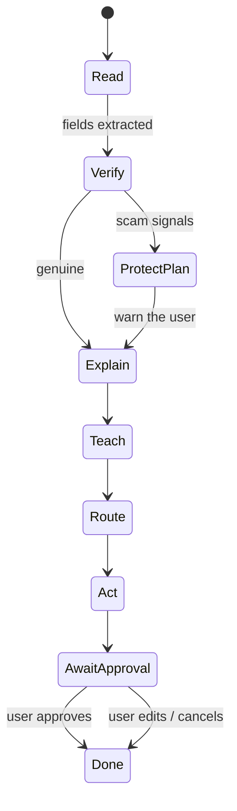

# Agent decision flow

## Stages and tools

| Stage | Tool | Output |
|---|---|---|
| Read | `ocr.read` | Raw text (Tesseract `msa+eng` if installed) |
| Read | `privacy.redact` | Text with `[IC]`, `[PHONE]`, `[ACCOUNT]`, `[NAME]` masked, plus counts |
| Read | `classify.issuer` | `LHDN · JPJ · PTPTN · PDRM · COURT · COUNCIL · BANK · UNKNOWN` with confidence |
| Read | `extract.fields` | Amount, deadline, reference |
| Verify | `scam.check` | `genuine`, `score` 0–100, `red_flags[]`, `good_signs[]` |
| Explain | `llm.explain` | Plain-language explanation in `bm / en / zh / ta` |
| Teach | `teach.lesson` | "Kenapa?" question and answer, plus glossary terms |
| Route | `gov.retrieve` | Online and walk-in steps, things to prepare, source URL, confidence |
| Route | `office.locate` | Nearest office, hours, booking (demo data) |
| Act | `act.draft` | Reply or report draft and a reminder; always `requires_approval` |

## Scam signals (rules)
- Transfer to a personal or company account
- Fake urgency (24 hours, "today only")
- Threat of arrest
- Asking for a TAC, OTP or password
- Moving the user to WhatsApp or Telegram
- Asking the user to keep it secret
- Asking for photos of the user's IC
- Unusual discounts
- Shortened links, or domains that are not official

Positive signals include official `.gov.my` or issuer domains, reference numbers in an official format, and content that matches a known issuer.

Score: `80 + 5 × good − 22 × red`, clamped to 0–100. The letter counts as genuine if the score is ≥ 60.

## Trace format
Each step is `{stage, kind, tool?, message, flag}`, where `kind ∈ think | tool | ok | bad | warn`. The dashboard streams the steps into the reasoning console, so judges can see the agent reason and use its tools.
