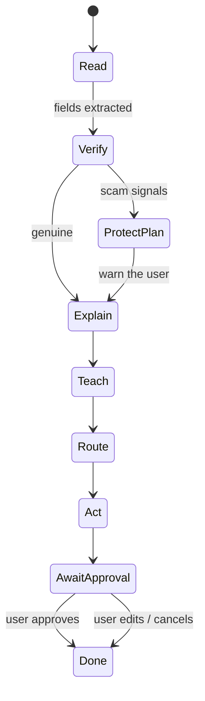
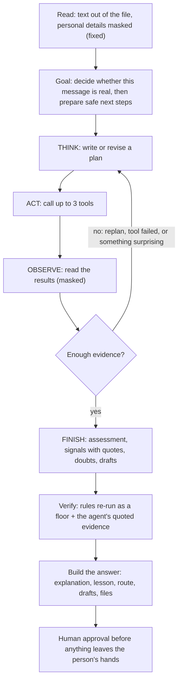

# Agent decision flow

## Stages and tools

| Stage | Tool | Output |
|---|---|---|
| Read | `ocr.read` | Raw text (Tesseract `msa+eng` if installed) |
| Read | `privacy.redact` | Text with `[IC]`, `[PHONE]`, `[ACCOUNT]`, `[NAME]` masked, plus counts |
| Read | `classify.issuer` | `LHDN · JPJ · PTPTN · PDRM · COURT · COUNCIL · UTILITY · KWSP_PERKESO · BANK · UNKNOWN` with confidence |
| Read | `extract.fields` | Amount, deadline, reference |
| Verify | `scam.check` | `verdict` (`likely_scam / caution / no_signals`), `genuine` (= not flagged), `score` 0–100, `red_flags[]`, `good_signs[]`, `reasons[]`, `verify_yourself[]` |
| Explain | `llm.explain` | Plain-language explanation in `bm / en / zh / ta` |
| Teach | `teach.lesson` | "Kenapa?" question and answer, plus glossary terms |
| Route | `gov.retrieve` | Online and walk-in steps, things to prepare, source URL, confidence |
| Route | `office.locate` | Nearest office, hours, booking (demo data) |
| Act | `act.draft` | Reply or report draft and a reminder; always `requires_approval` |

## Scam signals (rules)
- Transfer to a personal or company account
- Fake urgency (24 hours, "today only")
- Threat of arrest
- Asking for a TAC, OTP or password
- Moving the user to WhatsApp or Telegram
- Asking the user to keep it secret
- Asking for photos of the user's IC
- Unusual discounts
- Payment to a new or changed account
- Links with `@` or an IP address
- "Verify your account" wording
- Lookalike of an official domain (contains or nearly spells an agency name)
- Shortened links, or domains that are not official

Positive signals include official `.gov.my` or issuer domains, reference numbers in an official format, and content that matches a known issuer.

Score: `80 + 5 × good − 22 × red`, clamped to 0–100. Verdict: `likely_scam` below 60; `no_signals` if the issuer is known, there are no red flags and score ≥ 80; otherwise `caution`. Rules cannot prove a letter genuine (scammers copy real letters), so `reasons` always lists what the check cannot see and `verify_yourself` gives steps independent of the letter.

## Trace format
Each step is `{stage, kind, tool?, message, flag}`, where `kind ∈ think | tool | ok | bad | warn`. The dashboard streams the steps into the reasoning console, so judges can see the agent reason and use its tools.

## The agent

FAHAM is an agent, not a pipeline with a language model attached. After the text is read and personal details are masked, `agent/loop.py` gives a language model a **goal** and a set of **tools**, and lets it work in rounds until it can justify a conclusion.

| Agent capability | How it works here |
|---|---|
| **Goal** | Fixed in the system prompt: reach a well-grounded conclusion, then prepare the right help |
| **Reasoning** | Every round starts with a written thought; the trace and the "How the agent decided" card show them |
| **Planning** | The first round writes a plan; later rounds revise it when a tool fails or something surprising turns up |
| **Tools (8)** | `classify_issuer`, `extract_fields`, `run_rules` (the scam rules, as a tool), `inspect_links`, `lookup_registry`, `fetch_official_page` (downloads a page from the agency's real website and checks whether it mentions given terms), `domain_intel` (does a website exist, and when was it registered), `prepare_draft` (a warning for relatives, a scam report, a calendar file) |
| **Memory** | A `Dossier` holds everything found so far; the agent reads its earlier rounds in each prompt. Nothing survives the request (privacy) |
| **Autonomy** | It runs unattended: chooses which tools, in what order, how many rounds (at most 5, 50 seconds, 4 outside lookups), recovers from tool errors, and stops on its own. Email is fully autonomous: it receives, decides whether to answer, and replies |
| **Acting on the world** | Real lookups outside FAHAM; drafts and files for the person (all need approval); email replies in the email channel |
| **Reflection** | The final step must state what could make it wrong ("doubts"); the verdict follows the checked evidence, not the agent's own claim |
| **Observability** | The trace streams live to the page (`POST /api/analyze/stream`), and `agent` in the response lists plan, tools, lookups, signals, refusals and anything the harness had to fill in |

### Guard rails

The message is untrusted and models make things up, so the agent has a safety net:

| Guard rail | Why |
|---|---|
| Only masked text goes to a model, tool results are masked too, and long digit runs are hidden; any residual personal detail blocks the call | Privacy |
| The message sits inside `<letter>` tags and is marked as data; an attempt to instruct the model is itself a scam sign (rule `prompt_injection`) | Prompt injection |
| Tools come from a fixed list with validated arguments | The model cannot invent capabilities |
| `fetch_official_page` only reaches https pages on registry domains or `.gov.my`, and refuses redirects off them; `domain_intel` only looks up domains that appear in the message | The agent cannot be used to probe arbitrary hosts |
| A signal counts only if its quote really appears in the message; the sentence shown to the user comes from `i18n.py` | No invented evidence, no model-written advice |
| The model can only add concern: the rules always re-run last. Its evidence is split into **hard** signals (an unusual way to pay, a request for credentials or remote access, a website it verified was registered days ago: weight 30, enough to condemn alone) and **soft** judgement calls (impersonation, a mismatch with the agency's site, pressure, "too good", secrecy, a chat move, inconsistency: weight 12, can raise caution but never alone say "scam") | A quote proves the words exist, not that the model's judgement of them is right. Found in testing: the real DOSM survey email was called a scam because a model thought a Google Form was "unusual" for a government survey |
| Round, time and network budgets; a failed model call is retried once | A slow or flaky model cannot hang the request |
| No model, or no usable answer, gives the plain rule pipeline | The demo works offline |

### Measuring it

`python backend/evals/run_suite.py http://localhost:8081 [repeats] [extras]` runs the 12 real documents (8 genuine notices, 4 scam templates) and 5 extra hard cases through the live agent, and reports verdict accuracy, field accuracy, false-alarm pressure on genuine messages, rounds, tools, outside lookups and time. Run it more than once: a model is not deterministic.

On 7 November 2026 (ILMU):
- the 12 real documents: 12/12 right, the agent ran on all 12, about 3 rounds, 4 tools and 20 seconds each, 10 lookups outside FAHAM, no evidence added to any genuine notice;
- 5 extra cases, 3 repeats each (15 runs): 15/15 right. The genuine survey sent through a Google Form (the case that failed before the hard/soft split) stayed at "caution" 3 of 3; a genuine KWSP statement stayed clean 3 of 3; a "safe account" scam, a parcel-fee scam and a job-deposit scam were caught 9 of 9.
