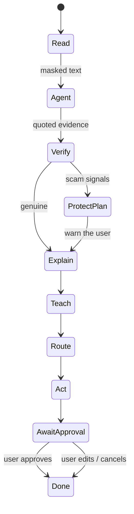

# Agent decision flow

## Stages and tools

| Stage | Tool | Output |
|---|---|---|
| Read | `ocr.read` | Raw text (Tesseract `msa+eng` if installed) |
| Read | `privacy.redact` | Text with `[IC]`, `[PHONE]`, `[ACCOUNT]`, `[NAME]` masked, plus counts |
| Read | `classify.issuer` | `LHDN · JPJ · PTPTN · PDRM · COURT · COUNCIL · UTILITY · KWSP_PERKESO · BANK · UNKNOWN` with confidence |
| Read | `extract.fields` | Amount, deadline, reference |
| Verify | `scam.check` | `verdict` (`likely_scam / caution / no_signals`), `genuine` (= not flagged), `score` 0–100, `scam_type`, `red_flags[]`, `good_signs[]`, `reasons[]`, `verify_yourself[]` |
| Explain | `llm.explain` | Plain-language explanation in `bm / en / zh / ta` |
| Teach | `teach.lesson` | "Kenapa?" question and answer, plus glossary terms. For a scam it is the lesson for that `scam_type`, in the chosen language |
| Route | `gov.retrieve` | Online and walk-in steps, things to prepare, source URL, confidence. For a scam the steps are the report-and-protect route for that `scam_type` (NSRC 997, bank hotline, Semak Mule), never an agency's payment steps |
| Route | `office.locate` | Nearest office, hours, booking (demo data, labelled "sample data") |
| Act | `act.draft` | Reply or report draft and a reminder; always `requires_approval`. A scam gets a report note, an unknown sender gets a verify-first checklist, and only an identified agency gets a letter to that agency |

## Scam signals (rules)
- Transfer to a personal or company account
- Fake urgency (24 hours, "today only")
- Threat of arrest
- Asking for a TAC, OTP or password
- Moving the user to WhatsApp or Telegram
- Asking the user to keep it secret
- Asking for photos of the user's IC
- Unusual discounts
- Payment to a new or changed account
- Links with `@` or an IP address
- **Family impersonation:** all three together: a new-number or broken-phone excuse, a family address word (mak, mum, 妈, அம்மா) and a money ask. One part alone does not fire
- Safe account, money-laundering accusation, frozen-account threat (BM, EN, 中文, தமிழ்)
- Guaranteed or very high returns, an upfront deposit or fee to start or register, a faraway stranger asking for money or for a friend's account, a prize you never entered for
- "Verify your account" wording
- Lookalike of an official domain (contains or nearly spells an agency name)
- Shortened links, or domains that are not official

Positive signals include official `.gov.my` or issuer domains, reference numbers in an official format, and content that matches a known issuer.

Score: `80 + 5 × good − Σ weight`, clamped to 0–100. Each red flag weighs 22, except `family_impersonation` 55, `safe_account` 30 and `laundering` 25. Any red flag or an unknown issuer caps the score at 79. **The verdict is a pure function of the score** (`verdict_from_score`): `likely_scam` below 60, `no_signals` from 80, otherwise `caution`, so score and verdict cannot disagree. Messages that are not from an agency are never answered with an agency template.

Scam types: `macau`, `family_impersonation`, `parcel`, `job`, `love`, `investment`, `phishing_refund`, `apk_install`, `other` (`scam_content.detect_scam_type`). Lesson, route and draft come from `scam_content.py` in all four languages. The accuracy of these rules is measured in [EVAL.md](EVAL.md). Rules cannot prove a letter genuine (scammers copy real letters), so `reasons` always lists what the check cannot see and `verify_yourself` gives steps independent of the letter.

## Prompt injection
The letter is data, never instructions. It is wrapped in `<letter>` tags with a system prompt that says to ignore instructions inside it; model output containing a web address that is not in the letter is dropped; the verdict comes from rules, not the model; and no tool sends, pays or submits. `tests/test_p3.py` checks each of these.

## Trace format
Each step is `{stage, kind, tool?, message, flag}`, where `kind ∈ think | tool | ok | bad | warn`. The dashboard streams the steps into the reasoning console, so judges can see the agent reason and use its tools.

## The agent

The model-driven part (goal, plan, tools, observations, guard rails, personal-data handling, how to tweak it) is documented in **[AGENT.md](AGENT.md)**. In short, between the Read and Verify rows above, an LLM works in rounds of think, act, observe with 8 tools (some reach official agency websites and domain records), then the harness checks its quoted evidence and re-runs the rules as a floor.

What `POST /api/analyze` adds for the agent:

- `agent`: `{mode, rounds, plan, tools, network, signals, refused, assessment, summary, doubts, filled}`
- `trace[].facts`: the structured result of a tool call (the page turns it into a plain sentence in the visitor's language)
- `action.extra`: drafts the agent chose to prepare (a warning for relatives, a scam report)
- `action.attachments`: files it made (a calendar reminder)
- `POST /api/analyze/stream`: the same run as server-sent events, one `step` per thought or tool call, then `result`
