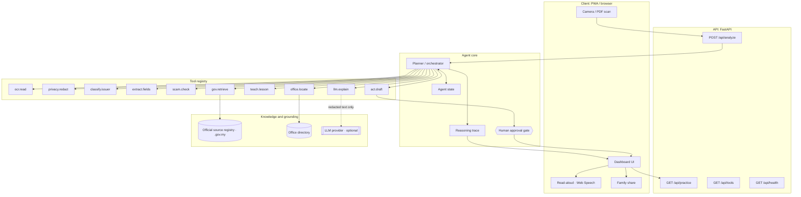
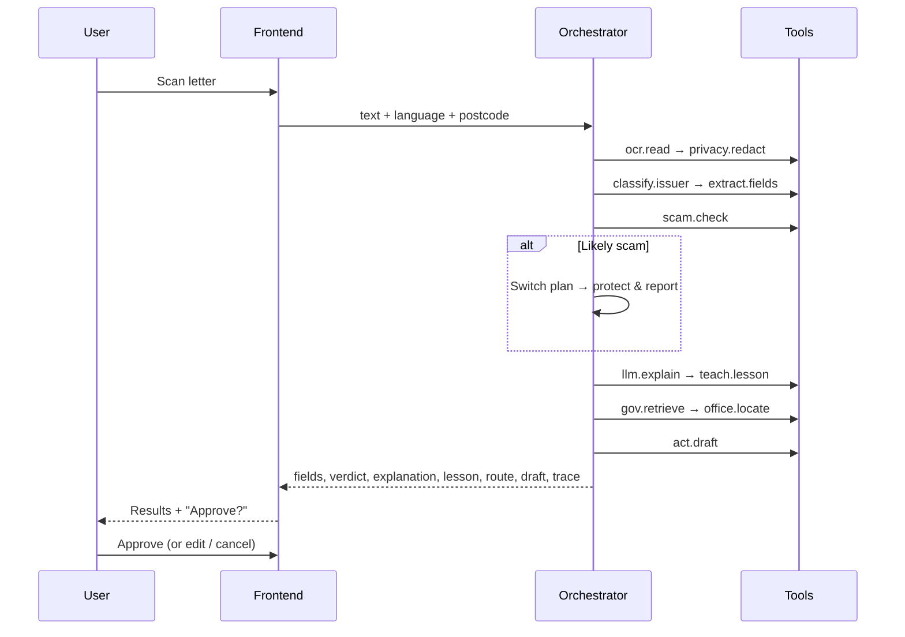

# FAHAM Architecture

## System overview



## Request lifecycle (`POST /api/analyze`)



## Layers

| Layer | Responsibility | Implementation |
|---|---|---|
| Client | Capture, display, read-aloud, approval | `frontend/` (vanilla JS, no build) |
| API | Typed contracts, CORS, docs | `backend/app/main.py`, `models.py` |
| Orchestrator | Plans tool calls, changes plan on evidence, records the trace | `backend/app/agent/orchestrator.py` |
| Tools | Small, testable, deterministic functions | `backend/app/agent/tools.py` |
| Grounding | Official URLs and procedures, office directory | `backend/app/data/*.json` |
| LLM | Optional wording polish; never decides actions | `backend/app/llm.py` |

## Design decisions

- **The agent decides, the rules are the floor.** An LLM plans, uses tools and gathers evidence ([AGENT.md](AGENT.md)); the scam rules re-run last, the model can only add concern, and every claim must quote the letter. With no model the rule pipeline runs, so the demo still works offline.
- **The plan changes on evidence.** A scam verdict switches the agent from "help comply" to "protect and report". This is the clearest sign that FAHAM is an agent and not a chatbot.
- **Human in the loop.** `act.draft` returns `requires_approval: true`. Nothing is sent or paid automatically.
- **Privacy by construction.** Redaction runs before any other tool sees the text. The API is stateless and stores no letters.
- **Teaching is part of the product.** `teach.lesson` runs on every letter, and the frontend keeps the learned glossary on the device.

## Extending

Add a tool:
```python
@tool("my.tool", "What it does")
def my_tool(...): ...
```
Then call it from `orchestrator.run()` and log it with `tr.call(stage, "my.tool", message)`.

Add an issuer: add an entry to `backend/app/data/official_sources.json` with `keywords`, `domains`, `source_url`, steps, lesson and terms.

## Production roadmap
- Live retrieval: fetch `source_url` at run time, extract the steps, and cache them with `retrieved_at`.
- An official office directory with geolocation and queue/booking integrations.
- On-device OCR (Tesseract WASM) so images never leave the phone.
- Measure the target metric: the full-help rate on repeat letter types for each user, stored on the device.
