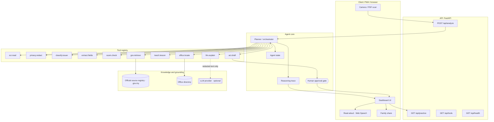
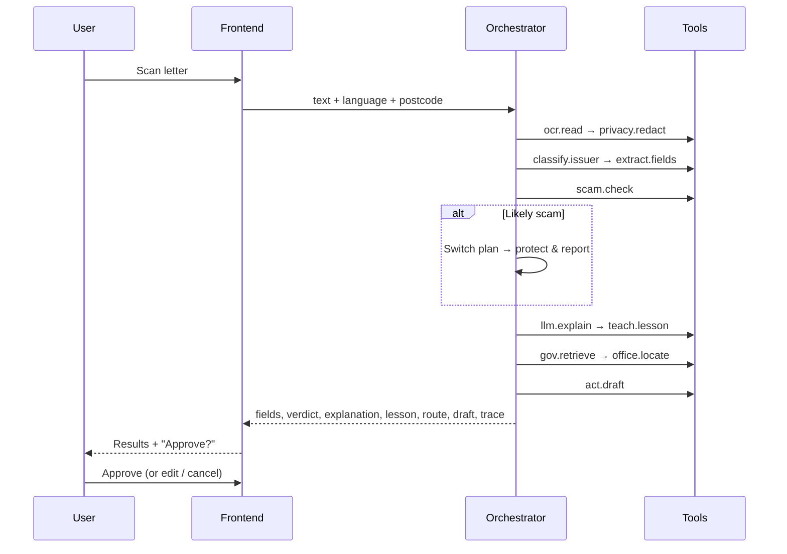

# FAHAM Architecture

## System overview



## Request lifecycle (`POST /api/analyze`)



## Streaming, cache and limits

`POST /api/analyze/stream` sends server-sent events so the user is never staring at a spinner:

1. `queue`: only while waiting, `{position, waiting}` ("you are number 3"). A first-in first-out limiter (`limiter.py`, `FAHAM_MAX_CONCURRENT`, default 4) decides who runs. A request that waits longer than `FAHAM_QUEUE_PATIENCE` gets `error` 503.
2. `verdict`: the rules-only verdict, score, scam type and reasons (`orchestrator.quick_verdict`), normally well under 2 seconds because it needs no network.
3. `explanation`: the plain-language text, after the optional LLM. The LLM call retries transient failures with exponential backoff (`llm._retry`); if it still fails, the template explanation is used, so the rules verdict is never lost.
4. `result`: the full `AnalyzeResponse`.

Identical tool calls inside one run are made once (`_Memo`). Finished analyses are cached in memory (`cache.py`, LRU, 1 hour) under a hash of the **redacted** text plus language, postcode and extra signals. The pipeline is deterministic (rules first, LLM at temperature 0), so a cache hit and a fresh run agree on verdict and score. When no LLM is configured, the bundled sample messages are pre-computed at start-up so the first tap on an example is instant.

Per-request extras are added after the cache, in `main._finish`: `entities` (accounts, phones, companies read from the request's own text, shown to the user for the Semak Mule shortcut, never cached or stored) and `others_checked` (a count from `counter.py`: SQLite rows of a one-way fingerprint, a count and two timestamps, deleted after 90 days).

## Offline safety tools and PWA

`frontend/assets/js/safety.js` holds three things that must work with no server: the **I already paid** card (bank hotline, NSRC 997, a script to read out, what to prepare; BM, EN, 中文, தமிழ்), the **Someone just called me** four-question guide, and **voice input** (Web Speech API; the Tamil voice falls back to a message when the device has none). `manifest.webmanifest` and `sw.js` make the app installable and cache the shell (network first, cache as fallback). The service worker never touches `/api/` or another origin, so no letter text or result is ever cached by the browser.

## MCP server (optional)

`backend/app/mcp_server.py` exposes the checker to MCP clients over stdio (`python -m app.mcp_server`, no extra package). Tools: `faham_check_message(text, language)` and `faham_list_scam_types()`. It runs the same pipeline, so personal details are redacted before any LLM call; the reply carries the redacted text only; nothing is logged or counted; no tool can send, pay or submit, and a draft comes back with `requires_approval: true`. Example client entry:

```json
{ "mcpServers": { "faham": { "command": "python", "args": ["-m", "app.mcp_server"], "cwd": "backend" } } }
```

## Layers

| Layer | Responsibility | Implementation |
|---|---|---|
| Client | Capture, display, read-aloud, approval | `frontend/` (vanilla JS, no build) |
| API | Typed contracts, CORS, docs | `backend/app/main.py`, `models.py` |
| Orchestrator | Plans tool calls, changes plan on evidence, records the trace | `backend/app/agent/orchestrator.py` |
| Tools | Small, testable, deterministic functions | `backend/app/agent/tools.py` |
| Grounding | Official URLs and procedures, office directory | `backend/app/data/*.json` |
| LLM | Optional wording polish; never decides actions | `backend/app/llm.py` |
| Cache, limiter, counter | Deterministic results reused, fair queue, hash-only "others checked" | `cache.py`, `limiter.py`, `counter.py` |
| MCP | Same checker for MCP clients | `backend/app/mcp_server.py` |

## Design decisions

- **The agent decides, the rules are the floor.** An LLM plans, uses tools and gathers evidence ([AGENT.md](AGENT.md)); the scam rules re-run last, the model can only add concern, and every claim must quote the letter. With no model the rule pipeline runs, so the demo still works offline.
- **The plan changes on evidence.** A scam verdict switches the agent from "help comply" to "protect and report". This is the clearest sign that FAHAM is an agent and not a chatbot.
- **Human in the loop.** `act.draft` returns `requires_approval: true`. Nothing is sent or paid automatically.
- **Privacy by construction.** Redaction runs before any other tool sees the text. The API stores no letters. The only server state is an in-memory cache of redacted results (1 hour) and a hash-only counter (90 days).
- **Teaching is part of the product.** `teach.lesson` runs on every letter, and the frontend keeps the learned glossary on the device.

## Extending

Add a tool:
```python
@tool("my.tool", "What it does")
def my_tool(...): ...
```
Then call it from `orchestrator.run()` and log it with `tr.call(stage, "my.tool", message)`.

Add an issuer: add an entry to `backend/app/data/official_sources.json` with `keywords`, `domains`, `source_url`, steps, lesson and terms.

## Production roadmap
- Live retrieval: fetch `source_url` at run time, extract the steps, and cache them with `retrieved_at`. Until then every source is shown as a saved copy with its last-checked date and flagged as sample data.
- An official office directory with geolocation and queue/booking integrations.
- On-device OCR (Tesseract WASM) so images never leave the phone.
- Measure the target metric: the full-help rate on repeat letter types for each user, stored on the device.
