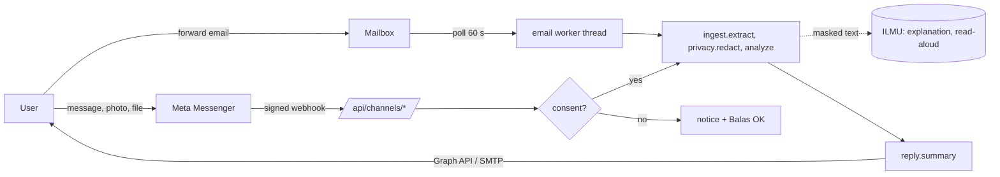

# Channel integrations

Code: `backend/app/channels.py` (routes, consent, limits), `backend/app/reply.py` (reply text). Stdlib only. Every channel is off until its env vars are set (see `backend/.env.example`). `GET /api/channels/...` returns 404 for an unconfigured channel.

## Data flow

## What you must set up

### Messenger
1. Create a Meta developer account and a Business app at developers.facebook.com, add Messenger. Create or choose a Facebook Page.
2. Generate a Page access token (`MESSENGER_PAGE_TOKEN`), set `MESSENGER_APP_SECRET`, `MESSENGER_VERIFY_TOKEN`, optional `MESSENGER_PAGE_USERNAME` (for m.me).
3. Webhook callback `https://<public-host>/api/channels/messenger`, subscribe to `messages`.
4. Production needs app review for `pages_messaging` plus business verification. Unreviewed apps only talk to people with a role on the app. Replies are only sent in response to a user message (24 hour window).

### Email
- Forwarding mailbox: create a dedicated mailbox (for example check@your-domain), set `IMAP_HOST/USER/PASSWORD` (IMAP over TLS, port 993) and `SMTP_HOST/PORT/USER/PASSWORD/FROM` (STARTTLS, port 587). Set `EMAIL_PUBLIC_ADDRESS` to show it on the site. The worker starts the first time `channels.status()` is called (the ingest agent's status/health route), then polls every `IMAP_POLL_SECONDS`. Gmail and Outlook need an app password; the account must allow IMAP.
- Webhook: `POST /api/channels/email` with header `X-FAHAM-Secret: <EMAIL_WEBHOOK_SECRET>` and the raw RFC822 message as the body (Mailgun/SendGrid inbound "raw MIME" mode). Returns the batch JSON; it never sends a reply.

### Website embed
No server work. `status()` reports `embed: true` and `allowed_embed_origins` from `FAHAM_EMBED_ORIGINS` (informational; the real CORS setting is `FAHAM_ALLOWED_ORIGINS`). The embed page belongs to the frontend.

## Env variables

| Variable | Used for |
|---|---|
| `FAHAM_PUBLIC_URL` | Terms link in the privacy notice |
| `FAHAM_EMBED_ORIGINS` | Informational list reported by status |
| `CHANNEL_HASH_KEY` | HMAC key for sender hashes (random per process if empty) |
| `GRAPH_VERSION` | Graph API version, default v21.0 |
| `MESSENGER_VERIFY_TOKEN`, `MESSENGER_APP_SECRET`, `MESSENGER_PAGE_TOKEN` | All three required to enable Messenger |
| `MESSENGER_PAGE_USERNAME` | m.me link |
| `IMAP_HOST`, `IMAP_PORT`, `IMAP_USER`, `IMAP_PASSWORD`, `IMAP_POLL_SECONDS` | Inbound mailbox |
| `SMTP_HOST`, `SMTP_PORT`, `SMTP_USER`, `SMTP_PASSWORD`, `SMTP_FROM` | Replies (host required with IMAP to enable) |
| `EMAIL_PUBLIC_ADDRESS` | Shown address |
| `EMAIL_WEBHOOK_SECRET` | Enables the raw MIME webhook |

### Unsupported
Supported files: PDF, Word (.docx), text, Markdown, email (.eml), images. ZIP and audio are rejected with 415; inside an .eml they are listed as skipped.

## Safety behaviour

- Signature `X-Hub-Signature-256` (HMAC-SHA256 of the raw body) is always checked when a Meta channel is configured; missing or wrong gives 403.
- The webhook returns 200 at once; work runs in a background task. Duplicate message ids are dropped (in-memory LRU, 1000).
- Consent: a sender's first message gets only the notice and "Balas OK untuk teruskan". Nothing is analysed or downloaded until OK, SETUJU, AGREE, 同意 or சம்மதம். STOP or BERHENTI removes them. Sender ids are kept only as salted HMAC hashes (30 day TTL).
- Limits: 10 messages per sender per hour, 300 per channel per hour, 25 MB per file, 20 s upstream timeouts, 5 emails per poll.
- Only Meta media URLs are fetched (https, host ends in fbcdn.net, facebook.com or fbsbx.com, no redirects). URLs inside messages are never fetched or echoed. User text is never echoed back (files are called "Fail 1", "Fail 2").
- Email replies go only to senders whose `Authentication-Results` has no `spf=fail`, `dkim=fail` or `dmarc=fail`, never to no-reply, bulk or auto-submitted mail, and at most once per sender per hour. A message with no Authentication-Results header at all is treated as not failed (a limitation: rely on your mailbox provider adding it). Mails are marked Seen; nothing is deleted or stored.
- Logs contain exception type names only.
- Restart forgets consent, dedup and rate limits (all in memory). Users are simply asked for OK again; an attacker could reset rate limits by forcing restarts, so run behind a platform limiter in production.

## Who sees what

| Party | Sees |
|---|---|
| Meta (Messenger) | Every message, file and FAHAM's reply, under Meta's terms. |
| Mail providers | The forwarded email and the reply |
| ILMU | Masked explanation text only (LLM explanation and read-aloud) |
| FAHAM server | Content in memory during processing only; salted hashes of sender ids in memory |

## PDPA 2010 notes (not legal advice, verify with counsel)

- Notice and consent: the first reply is the notice, and analysis starts only after an explicit reply. Consent is withdrawn with STOP.
- Retention: none by design. No database, no content logs. The only state is in-memory hashes, lost on restart.
- Cross-border transfer: Meta and possibly ILMU process data outside your control; disclose it in the terms page (`FAHAM_PUBLIC_URL/terms` is a placeholder that must exist).
- Users may send other people's data (a parent's letter). Say so in the terms.

## Costs

Messenger replies in the window are free. Tunnel or hosting with public HTTPS, a domain, a mailbox, SMTP sending, and ILMU usage (LLM and TTS are per use, see `.env.example`). Business verification can need company documents but is free.

## What is tested and what is not

Tested (`backend/tests/test_channels.py`, simulated payloads, `ingest` and the network monkeypatched): handshake accept and reject, signature accept and reject, consent gating, STOP, reply language and wording, dedup, status update and echo ignoring, host allow-list and size cap, rate limit, status without secrets, email rejection on spf/dkim/dmarc fail and one reply per sender, email webhook secret.

Not tested: anything live. No real Meta app, Page, webhook delivery, media download, Graph reply, IMAP login or SMTP send has been run. The real Meta payload shapes are coded from the public docs and may differ in detail (for example media URL hosts). The IMAP fetch loop and SMTP sending are untested beyond `process_email`. zh and ta strings are unreviewed.
